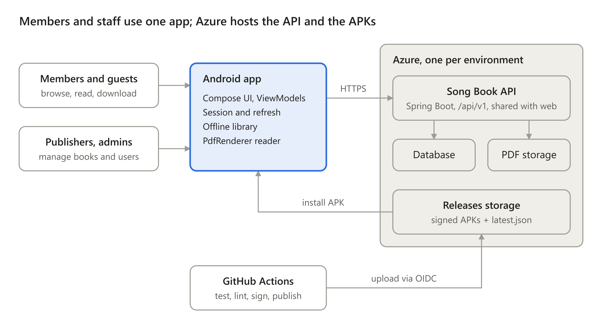
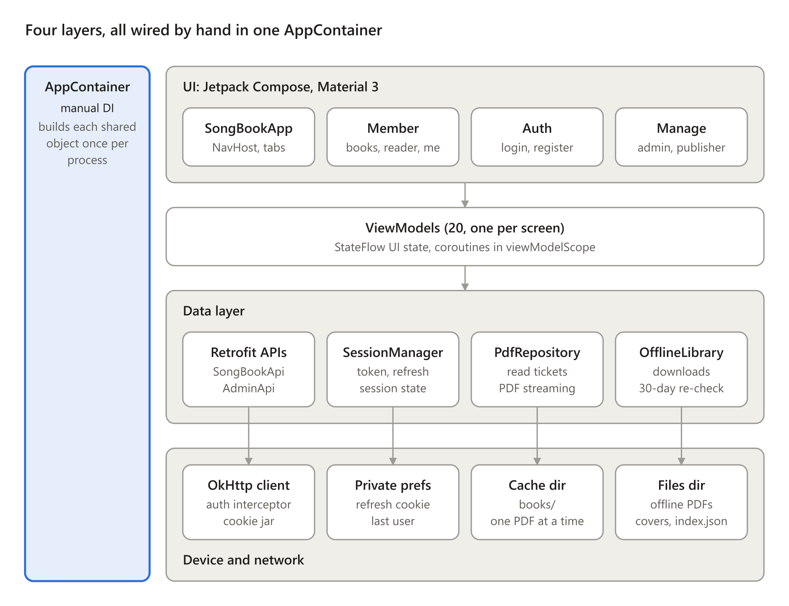
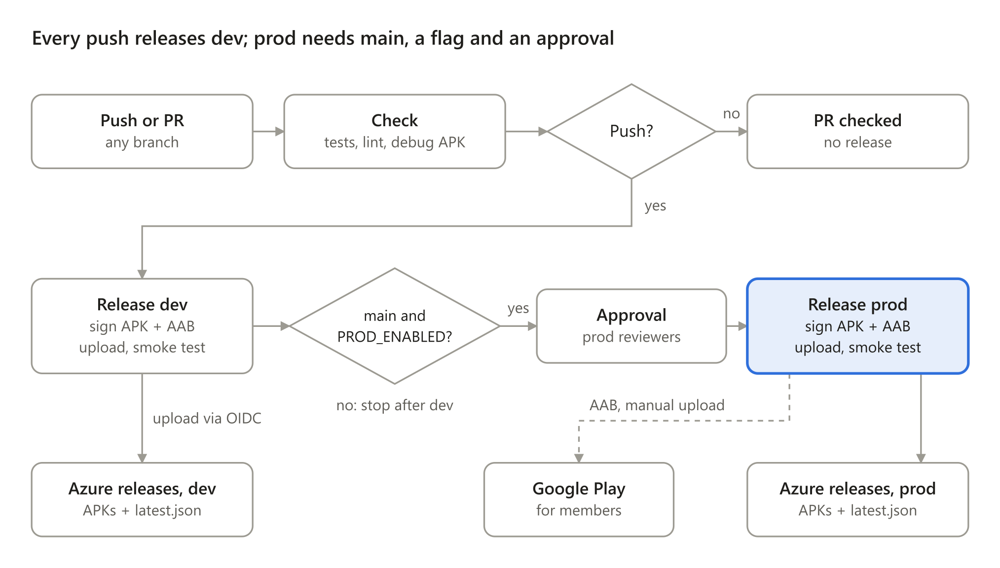
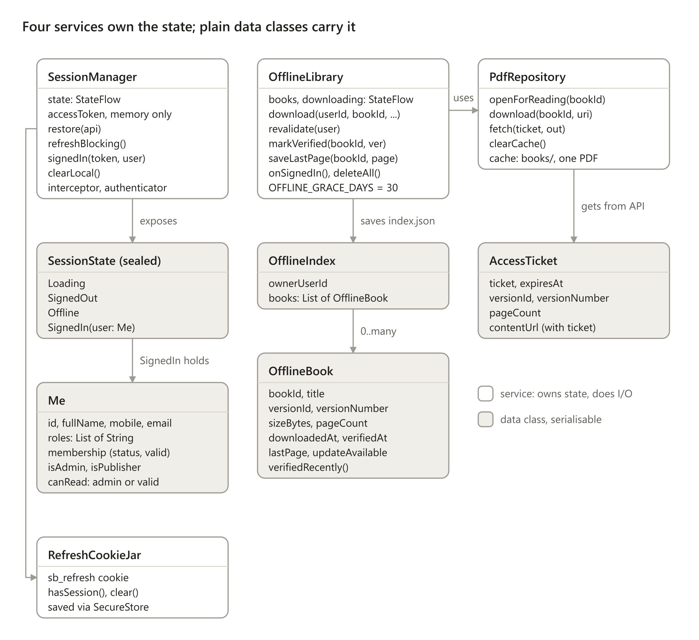
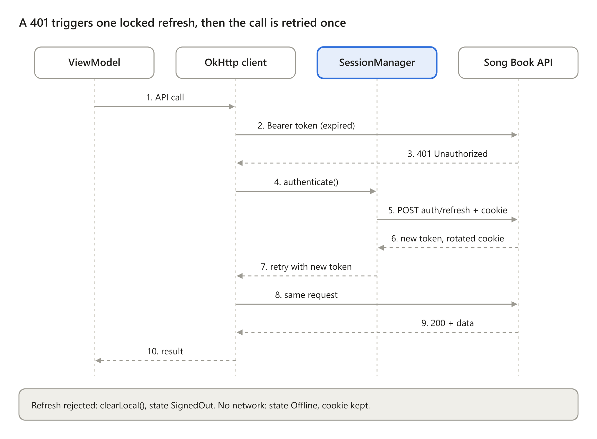
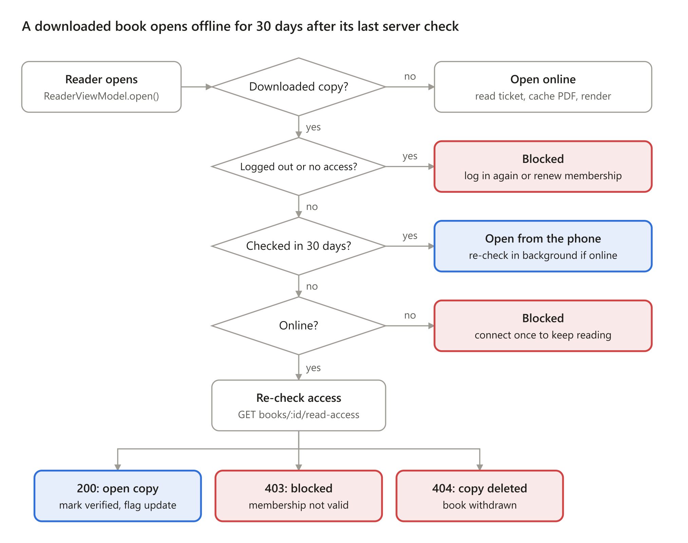

# Song Book App — High & Low Level Design

As of 2026-11-22 (branch `feature/offline-admin`). Diagrams are in [`images/`](images/) as PNG (embedded here) and SVG (scalable, same picture).

**Contents**

- [Overview](#overview)
- [HLD: system context](#hld-system-context)
- [HLD: app architecture](#hld-app-architecture)
- [HLD: deployment and environments](#hld-deployment-and-environments)
- [LLD: packages and responsibilities](#lld-packages-and-responsibilities)
- [LLD: classes and data model](#lld-classes-and-data-model)
- [LLD: key flows](#lld-key-flows)
- [LLD: API endpoints used by the app](#lld-api-endpoints-used-by-the-app)
- [Cross-cutting concerns](#cross-cutting-concerns)
- [Risks and open questions](#risks-and-open-questions)

## Overview

IMS Books is a native Android client for the Song Book Library. It reuses the existing Spring Boot API on Azure (the
same one the web app uses) with no backend changes, and adds offline reading that the web app does not have.

| Role | What they can do in the app |
| --- | --- |
| Guest | Browse and search the catalogue, open book details, register or log in |
| Member | Read PDFs online, download books for offline use, track reading progress, manage profile, raise correction requests |
| Publisher | Everything a member can, plus a Manage tab limited to the books they uploaded (create, edit, new PDF versions, archive) |
| Administrator | Full Manage tab: dashboard, users and roles, memberships, all books, categories, request review, audit log |

**Stack:** Kotlin, Jetpack Compose (Material 3), type-safe Navigation, Retrofit + OkHttp + kotlinx.serialization,
Coil 3 for covers, Android `PdfRenderer` for pages. minSdk 26 (Android 8), target/compile SDK 37.

**Out of scope:** the backend, database and PDF storage. They live in the `Song-book-Webapp` repository and are
treated here as an external system.

## HLD: system context

The app is a pure client: every read and write goes over HTTPS to the same Song Book API the web app uses.

The API owns the database and PDF storage; the app never touches them directly. GitHub Actions publishes signed APKs
to a separate releases storage account per environment.

## HLD: app architecture

The app follows a layered MVVM design: Compose screens observe ViewModel state, and ViewModels call the data layer.
Everything is wired by hand in one `AppContainer`.

Most ViewModels call the Retrofit APIs directly; only session, PDF reading and offline downloads have dedicated
classes. There is no local database: offline state is a JSON index beside the files, and the reader renders pages
with Android `PdfRenderer` into an in-memory bitmap cache.

## HLD: deployment and environments

Three build flavours map to three environments, and each can be installed side by side.

| Flavour | Application id | API origin |
| --- | --- | --- |
| `local` | `com.imsbooks.songbook.local` | `http://10.0.2.2:8080` (emulator to the developer's PC) |
| `dev` | `com.imsbooks.songbook.dev` | Dev API on Azure (`API_ORIGIN` of the GitHub `dev` environment) |
| `prod` | `com.imsbooks.songbook` | Prod API on Azure (`API_ORIGIN` of the GitHub `prod` environment) |

Every push releases dev; prod needs `main`, a flag and an approval.

Workflows: `.github/workflows/android.yml` (check + orchestration) and `.github/workflows/android-release.yml`
(build, sign, publish, smoke test). Releases sign with a keystore held in repository secrets and log in to Azure with
GitHub OIDC (no stored Azure keys). Azure APKs suit testers; members should get the prod AAB through Google Play.

## LLD: packages and responsibilities

The app is one Gradle module (`:app`) under `com.imsbooks.songbook`, about 7,500 lines across 65 tracked files.
Wiring is manual: `AppContainer` builds every shared object once per process, and each ViewModel takes the container
in its constructor.

| Package | Key types | Responsibility |
| --- | --- | --- |
| (root) | `SongBookApplication`, `AppContainer`, `MainActivity` | Process entry, manual DI, Compose host |
| `data` | `SongBookApi`, `AdminApi`, `ApiModels`, `ApiException` | Retrofit interfaces and DTOs for `/api/v1/`, error mapping |
| `data` | `PdfRepository` | Read/download tickets, streams a PDF to the private cache (one book kept) or to a user-picked file |
| `data` | `OfflineLibrary`, `OfflineBook` | Offline downloads: files, `index.json`, owner account, 30-day re-check, update flag, last page |
| `data` | `Uploads` | Streamed multipart upload from a Storage Access Framework URI |
| `data.session` | `SessionManager`, `SessionState` | In-memory access token, single-flight refresh, auth interceptor and authenticator, session state flow |
| `data.session` | `RefreshCookieJar`, `SecureStore`, `SecureUserCache` | Persists the `sb_refresh` cookie and last user in private prefs; one-time migration from the old Keystore copy |
| `ui` | `SongBookApp` | `NavHost`, type-safe routes, bottom tabs (Books, Downloads, My library, Manage) |
| `ui.catalogue`, `ui.book` | `CatalogueViewModel`, `BookDetailViewModel` | Search, filter, paging; book detail, read, download, save a copy |
| `ui.auth` | `LoginViewModel`, `RegisterViewModel`, `ForgotPasswordViewModel` | Mobile-number sign-in, registration, SMS-code reset |
| `ui.member` | `MeViewModel`, `ProfileViewModel`, `RequestsViewModel` | Membership, history, profile, correction requests |
| `ui.reader` | `ReaderViewModel` | `PdfRenderer`, bitmap LRU cache, online/offline open, progress save |
| `ui.downloads` | `DownloadsScreen` | Lists offline books, storage used, delete |
| `ui.admin` | `AdminHomeViewModel`, `UsersViewModel`, `MembershipsViewModel`, `AdminBooksViewModel`, `BookEditViewModel`, `CategoriesViewModel`, `RequestsReviewViewModel`, `AuditViewModel` | Management area; publishers see only their own books |
| `util` | `Mobile`, `Format` | Mobile-number rules shared with backend/web, date formatting |

## LLD: classes and data model

Four services hold all long-lived state; everything else is an immutable, serialisable data class.

`OfflineLibrary` guards its index with a coroutine `Mutex`; `SessionManager` guards token refresh with a JVM lock so
only one refresh is ever in flight. Role checks (`isAdmin`, `isPublisher`, `canRead`) mirror the backend's rules but
are only for showing or hiding UI.

## LLD: key flows

Two flows carry most of the design risk: keeping the session alive, and deciding whether an offline copy may open.

### Token refresh

On app start, `SessionManager.restore()` runs the same refresh to rebuild the session from the saved cookie.

If two calls get a 401 at once, the second waits on the lock and reuses the token the first one fetched, so the
backend never sees a refresh token twice.

### Opening a book

`ReaderViewModel.open()` decides between the online and offline paths. A downloaded book opens offline for 30 days
after its last server check.

When online, the app also re-checks every download on sign-in. Reading progress is saved on the phone while offline
and sent to the server when it is reachable.

### Publisher and admin actions

These follow the plain ViewModel-to-API path. Book uploads stream the picked file as multipart through `uploadApi`
(10-minute write timeout); the API returns 404 when a publisher touches another publisher's book.

## LLD: API endpoints used by the app

The app declares 44 endpoints (21 member, 23 management), plus the content URL a ticket returns. Paths are relative to
`{API_ORIGIN}/api/v1/`. Member calls are declared in `SongBookApi`, management calls in `AdminApi`.

| Area | Method and path | Used for |
| --- | --- | --- |
| Auth | `POST auth/login`, `auth/register`, `auth/refresh`, `auth/logout` | Sign-in, registration, token rotation, sign-out |
| Auth | `POST auth/forgot-password`, `auth/reset-password` | SMS-code password reset |
| Account | `GET` / `PUT users/me`, `PUT users/me/password` | Profile, change password |
| Account | `POST users/me/mobile`, `users/me/mobile/confirm` | Change mobile number with SMS code |
| Catalogue | `GET categories`, `GET books`, `GET books/{id}` | Browse, search, detail |
| Content | `GET books/{id}/read-access` | Read ticket; also the eligibility re-check for offline copies |
| Content | `GET books/{id}/download-access` | Download ticket (audited as a download) |
| Content | `GET {ticket.contentUrl}` | Streams the PDF bytes |
| Progress | `GET` / `PUT members/books/{id}/progress`, `GET members/progress` | Resume page, reading history |
| Requests | `GET members/modification-requests`, `POST modification-requests` | Member correction requests |
| Admin | `GET admin/stats` | Dashboard counts |
| Admin | `GET` / `POST admin/users`, `GET` / `PUT admin/users/{id}` | Users and roles |
| Admin | `GET` / `POST admin/memberships`, `PUT admin/memberships/{id}` | Memberships |
| Admin | `GET` / `POST admin/categories`, `PUT admin/categories/{id}` | Categories |
| Admin | `GET` / `POST admin/books`, `GET` / `PUT admin/books/{id}`, `PUT admin/books/{id}/cover`, `POST admin/books/{id}/archive` | Books (publishers: own books only, else 404) |
| Admin | `GET` / `POST admin/books/{id}/versions`, `GET admin/books/{id}/versions/{versionId}/content` | PDF versions |
| Admin | `GET admin/modification-requests`, `PUT admin/modification-requests/{id}` | Approve or reject requests |
| Admin | `GET admin/audit-logs` | Audit log |

## Cross-cutting concerns

The server stays the single authority on who may read what; the app only caches what the server has recently
allowed.

| Concern | Design |
| --- | --- |
| Tokens | 15-minute access token held in memory only. The `sb_refresh` HttpOnly cookie (14-day session) is saved synchronously in private storage, excluded from backups and device transfer. |
| Refresh | A 401 triggers one single-flight refresh under a lock, then a retry. The backend treats refresh-token reuse as theft, so refreshes never overlap. A rejected refresh signs the user out. |
| Transport | HTTPS only. Plain HTTP is allowed only in debug builds and only to `10.0.2.2` / `localhost`. |
| Authorisation | The Manage tab shows only for admins and publishers, and each management screen re-checks the role. The API enforces every rule regardless. |
| Offline eligibility | A downloaded copy opens offline for 30 days after its last successful `/read-access` check, then needs one connection. A 404 deletes the copy; a 403 blocks reading. |
| Account isolation | Downloads belong to one account. Logging out deletes them; a different member signing in deletes the previous account's copies. |
| Large files | Reading uses a seekable file in the private cache (one book kept). Uploads stream from the picked URI, so a 100 MB PDF is never held in memory; uploads get 10-minute write timeouts. |
| Errors | HTTP errors become `ApiException(status, body)`. Status 0 or 5xx means unreachable; 403 and 404 map to user-facing eligibility messages. |
| Atomic writes | PDFs download to a `.part` file and are renamed when complete; `index.json` is written via a temp file. |

**Testing.** Unit tests cover mobile-number rules (`MobileTest`), cookie jar and refresh/retry (`SessionTest`), cookie
survival across restart (`CookieRestartTest`) and the offline library (`OfflineLibraryTest`). One on-device test
(`SecureSessionDeviceTest`) checks the session survives an app restart. CI runs unit tests, lint and a debug build on
every push and pull request.

## Risks and open questions

The biggest open item is the placeholder application id, because it cannot change after the first Play upload.

| Risk or question | Impact | Suggested action |
| --- | --- | --- |
| Application id `com.imsbooks.songbook` is a placeholder | Locked forever after the first Play upload | Pick a domain the organisation controls before Play release |
| Offline PDFs are stored unencrypted in app-private files | Readable on a rooted device; a revoked member keeps offline access for up to 30 days | Accept, shorten the grace period, or encrypt files at rest |
| Refresh cookie in plain private prefs (Keystore wrapping dropped for reliability) | Relies on the Android sandbox alone | Accept; revisit if a device-bound key becomes reliable on target devices |
| Upload signing key lives only in GitHub secrets and a local backup | Losing it means installed users cannot update | Keep an offline backup; enrol in Play App Signing |
| Azure-hosted APKs need "install unknown apps" | Friction for members | Use Azure APKs for testers, Google Play for members |
| UI flows have no automated tests (one device test only) | Regressions in navigation and admin screens slip through | Add Compose UI tests for sign-in, reader and book upload |
| Manual DI in `AppContainer` | Fine at this size; grows harder to test | Revisit Hilt if the container passes ~30 objects |
